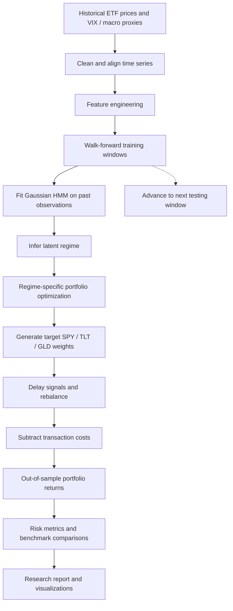

<div align="center">

# RegimeIQ
### Macro-Aware Tactical Asset Allocation Engine

**Detect market regimes. Adapt portfolio weights. Evaluate performance without peeking into the future.**


[Overview](#overview) • [Architecture](#system-architecture) • [Methodology](#methodology) • [Results](#historical-backtest-results) • [Getting Started](#getting-started) • [Limitations](#limitations-and-research-integrity)

</div>

---

## Overview

Financial markets do not remain in one statistical state. Periods of growth, uncertainty, recovery, and crisis have different risk-return characteristics, which can make an allocation that performs well in one environment unsuitable in another.

**RegimeIQ** is a research-oriented asset allocation framework that uses an **unsupervised Gaussian Hidden Markov Model (HMM)** to infer latent market regimes from historical asset and macro-market features. It then maps those regimes to diversified allocations among equities, U.S. Treasury bonds, and gold, and evaluates the strategy through a temporally ordered backtesting workflow.

The objective is **regime-aware risk management and portfolio construction**, not guaranteed returns or perfect market timing.

### Research questions

- Can unsupervised learning distinguish economically meaningful market regimes?
- Can regime-dependent allocations improve risk-adjusted results relative to static portfolios?
- How robust is performance to realistic signal delays and transaction costs?
- What happens to drawdowns during market stress?

## Key Capabilities

| Capability | Approach |
| --- | --- |
| Market state discovery | Gaussian Hidden Markov Model with five latent states |
| Market features | Historical returns, volatility, momentum, correlations, VIX and macro proxies |
| Investable universe | **SPY** (equities), **TLT** (long-duration Treasuries), **GLD** (gold) |
| Adaptive allocation | Regime-conditional constrained portfolio weights |
| Temporal evaluation | Walk-forward train/test process and one-day signal shifting |
| Execution realism | Turnover-based transaction friction modeling |
| Baselines | SPY buy-and-hold, equal-weight and 60/40 allocations |
| Performance review | CAGR, Sharpe, Sortino, maximum drawdown, Calmar and total return |

## System Architecture



> This diagram describes the research workflow documented by the repository; inspect the notebooks for the exact implementations and experiment parameters.

## Methodology

### 1. Feature engineering

Market observations are transformed into a feature set representing price direction, risk, and changing market conditions. The project describes using:

- ETF and/or market returns
- Rolling volatility and momentum
- Rolling relationships or correlations between assets
- VIX and related market/macro indicators

Features should be computed using information available at the relevant historical timestamp, with any normalizers fitted exclusively to training data during walk-forward evaluation.

### 2. Hidden Markov Model for regime discovery

The HMM assumes an unobserved discrete regime that evolves through a transition process and produces observable market features. The conditional observation model is Gaussian:

\[
P(z_t\mid z_{t-1}), \qquad x_t \mid z_t=k \sim \mathcal{N}(\mu_k,\Sigma_k)
\]

Here, `x_t` represents observed market features and `z_t` is the hidden regime. Regime IDs are arbitrary labels learned by the model; they acquire economic meaning only after examining their historical feature and return characteristics.

The repository reports **five** market regimes:

| State ID | Interpretation in the project |
| :---: | --- |
| 0 | Transition Market |
| 1 | Volatile Recovery |
| 2 | Stable Defensive Growth |
| 3 | Crisis Opportunity |
| 4 | Long-Term Bull Market |

**Important:** These descriptions summarize the project's historical fitted states; state meanings and numeric IDs may change on retraining.

### 3. Regime-aware portfolio optimization

For the three-asset universe, a target portfolio assigns weights to SPY, TLT and GLD. The optimization adapts to inferred market conditions instead of maintaining fixed weights in all states.

The repository reports the following regime-conditional weights:

| Regime | SPY | TLT | GLD |
| :---: | ---: | ---: | ---: |
| 0 | 100% | 0% | 0% |
| 1 | 81% | 0% | 19% |
| 2 | 32% | 61% | 7% |
| 3 | 0% | 61% | 39% |
| 4 | 84% | 0% | 16% |

These values are **reported research outputs**, not recommendations or live target allocations. Optimization details and constraints are best verified in the portfolio-optimization notebook.

### 4. Walk-forward evaluation and transaction costs

A credible historical test should keep training information separate from subsequent test periods:


The repository documents a walk-forward framework, a one-day shift between signal and action, and turnover-based transaction friction (the project objective mentions 5–10 basis points per rebalance-related turnover). Exact dates, refitting intervals and applied fee assumptions should be taken from the notebooks rather than inferred from the README.

A simple stylized after-cost return relation is:

\[
r^{\text{net}}_t = w_{t-1}^{\top}r_t - c\,\lVert w_t-w_{t-1}\rVert_1
\]

where the turnover convention and cost coefficient `c` must match the actual backtest implementation.

## Historical Backtest Results

The figures below are **reported in the original repository README**. They have **not been independently rerun or audited**; treat them as research results, not forward-looking expectations.

| Metric | Reported dynamic strategy |
| --- | ---: |
| Total return | 1,217% |
| Compound annual growth rate (CAGR) | **13.01%** |
| Sharpe ratio | **1.00** |
| Sortino ratio | 1.27 |
| Maximum drawdown | **−27.3%** |
| Calmar ratio | 0.48 |

### Benchmark comparison

| Strategy | CAGR | Sharpe | Max drawdown |
| --- | ---: | ---: | ---: |
| **Regime-aware dynamic strategy** | **13.0%** | **1.00** | **−27%** |
| Buy and hold SPY | 9.0% | 0.55 | −60% |
| Equal-weight portfolio | 7.7% | 0.80 | −24% |
| Static 60/40 portfolio | 7.0% | 0.67 | −35% |

The reported dynamic strategy has a higher CAGR and Sharpe ratio than the listed baselines, but the equal-weight portfolio shows a smaller maximum drawdown. Return comparisons are meaningful only when evaluated using the **same period, return frequency, fee assumptions and data conventions**.

## Project Structure

The repository's existing documentation describes the following research organization. **Folder spelling and contents should be checked against the checked-out repository before using these paths**:

```text
Regime Shift Project/
├── notebooks/
│   ├── Notebook 1 - Data Exploration.ipynb
│   ├── Notebook 2 - Feature Engineering.ipynb
│   ├── Notebook 3 - HMM Theory.ipynb
│   ├── Notebook 4 - HMM Regime Detection.ipynb
│   ├── Notebook 5 - Portfolio Optimization.ipynb
│   ├── Notebook 6 - Backtesting.ipynb
│   ├── Notebook 7 - Performance Analysis.ipynb
│   └── Notebook 8 - Final Report.pdf
├── data/
│   ├── raw_prices.csv
│   ├── engineered_features.csv
│   └── regime_predictions.csv
├── results/
│   ├── figures/
│   ├── tables/
│   └── models/
└── research_notes.md
README.md
```

## Getting Started

### Prerequisites

- Python 3.10+ (suggested local environment; not a confirmed project requirement)
- JupyterLab or Jupyter Notebook
- Internet access if running notebooks that download market prices

### Clone the repository

```bash
git clone https://github.com/purav-12345/RegimeIQ-Quantitative-Portfolio-Engine.git
cd RegimeIQ-Quantitative-Portfolio-Engine
```

### Set up a Python environment

```bash
python -m venv .venv
# macOS / Linux
source .venv/bin/activate
# Windows PowerShell
# .venv\Scripts\Activate.ps1
```


```bash
python -m pip install jupyterlab numpy pandas scipy scikit-learn hmmlearn matplotlib seaborn yfinance
```

### Explore the research notebooks

```bash
jupyter lab
```

Open the project's `notebooks/` folder in JupyterLab and follow the numbered notebook sequence from data exploration through evaluation. Run them in order if later notebooks depend on intermediate files written by earlier ones.

> The repository is presented as a notebook-based research project, not a production trading API, web application, or one-command executable. Execution has not been validated in this documentation pass.

## How to Interpret the Results

The reported findings suggest that market-regime adaptation *may* improve performance relative to static allocations in the chosen historical experiment. However:

- **Historical performance is not a guarantee** of future returns.
- HMM regimes are latent statistical clusters, not objective real-world economic labels.
- A one-day signal shift addresses one form of look-ahead bias, but all feature construction, preprocessing and parameter tuning must also respect time ordering.
- Reported results can be sensitive to the sample period, ETF history, benchmark setup, transaction costs and rebalancing policy.
- The evaluation should distinguish between true out-of-sample results and any development/selection period.
- Transaction costs, slippage, taxes and operational constraints may differ from simplified backtest assumptions.

## Future Work

- Rolling or online HMM updates and regime probability calibration
- Sensitivity analysis over state counts, training windows and rebalance frequency
- Robust optimization with turnover and allocation constraints
- Expanded macroeconomic covariates and multi-asset universes
- Stress tests, bootstrapping and multiple-testing-aware performance assessment
- Out-of-sample paper trading before any live deployment

**Educational and research use only.** This repository does not provide investment advice or guaranteed investment performance. Any real-money use requires independent verification, risk review, and appropriate controls.
